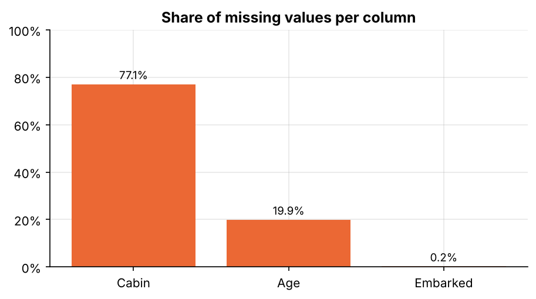
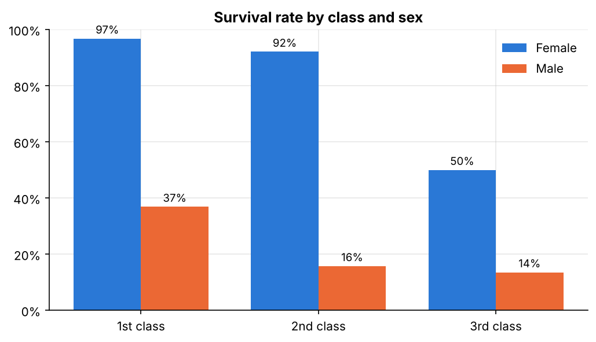
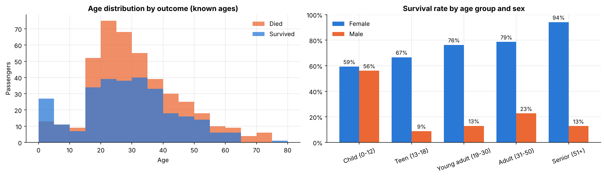
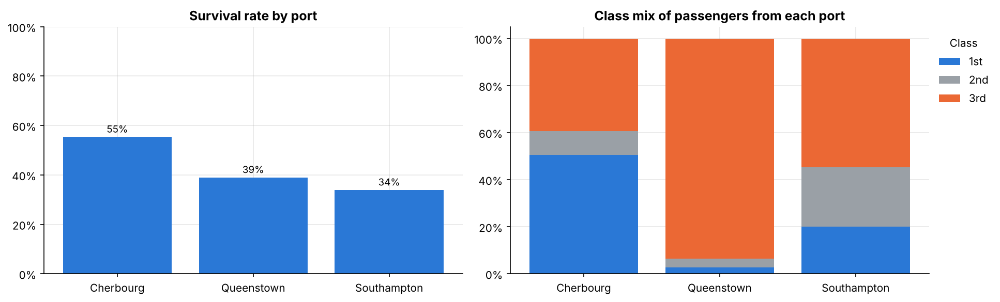
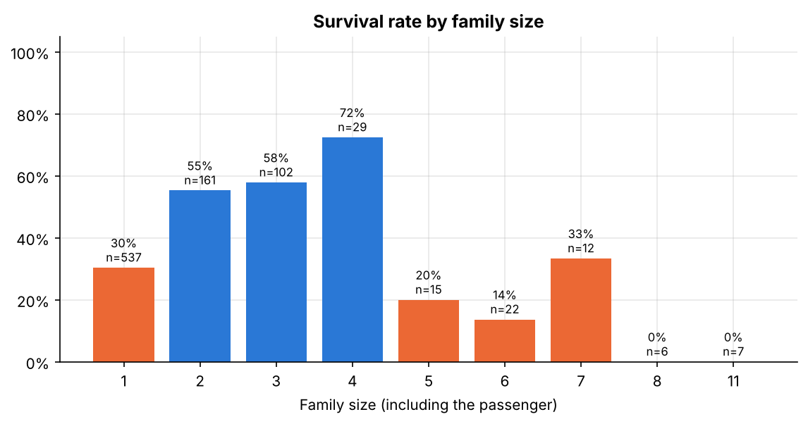
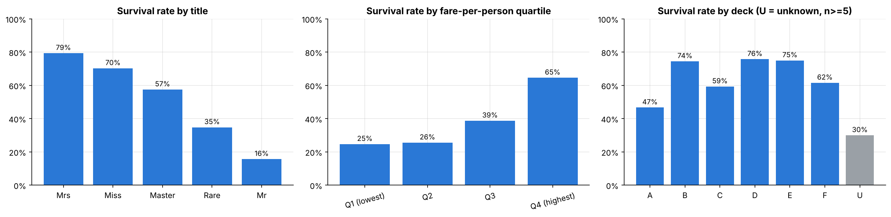
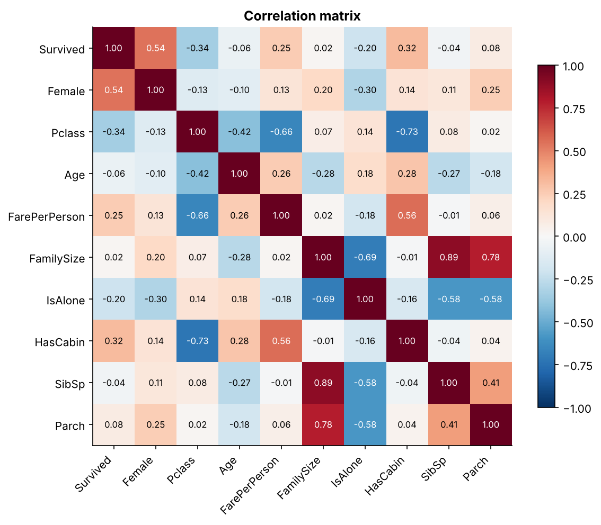

# Task 02: Titanic Data Cleaning and EDA

Task 02 of the Prodigy InfoTech Data Science Internship: perform data cleaning and exploratory data analysis (EDA) on a dataset, explore the relationships between variables and identify patterns and trends.

## Problem

Which passenger characteristics were associated with surviving the Titanic, and how strongly? I treated this as the first step of a classification problem (target = `Survived`) and tested five hypotheses before any modelling:

| # | Hypothesis | Result |
|---|---|---|
| H1 | Women survived more than men | Supported (74% vs 19%) |
| H2 | Higher classes survived more | Supported (63% / 47% / 24%) |
| H3 | Children survived more | Partly (under 13: 58%, little age effect after that) |
| H4 | Port of embarkation mattered | Mostly confounded by class |
| H5 | Family size mattered | Supported, but non-linear |

## Data

Kaggle Titanic training set: 891 passengers, 12 columns. I used the copy from Prodigy's [sample datasets repo](https://github.com/Prodigy-InfoTech/data-science-datasets/tree/main/Task%202). The notebook reads it directly from there.

## Cleaning

| Problem | Fix |
|---|---|
| Cabin 77% missing | Kept a `HasCabin` flag and the deck letter; unknown = `U` |
| Age 20% missing | Median age by title (Mr, Mrs, Miss, Master, Rare) and class, plus an `AgeMissing` flag |
| Embarked 2 missing | Both on ticket 113572; historical records show they boarded at Southampton |
| Fare covers whole ticket | Added `FarePerPerson` = Fare / passengers on the same ticket |
| 15 zero fares, 512 max fare | Checked and kept: both are real records |

New features: `Title`, `FamilySize`, `FamilyGroup`, `IsAlone`, `AgeGroup`, `TicketCount`, `Deck`. The cleaned data is saved to `titanic_clean.csv`.

## Charts

Sex mattered far more than class. A 3rd-class woman had a better chance than a 1st-class man:

Cherbourg looks safest, but that's because half its passengers were in 1st class:

Family size has an inverted-U shape:

## Findings

1. 38% of passengers in this set survived (342 of 891).
2. Sex is the strongest single factor (correlation 0.54). 74% of women survived vs 19% of men.
3. Over 90% of 1st and 2nd-class women survived, but only 50% of 3rd-class women. A 1st-class man had 37%.
4. Boys under 13 survived at 56% compared with 16% for adult men. Title captures this better than raw age.
5. Cherbourg's 55% survival rate is mostly explained by its class mix (51% 1st class vs 20% from Southampton).
6. Passengers alone survived at 30%, families of 2-4 at 55-72%, and families of 5+ mostly 20% or lower. None of the 13 people in families of 8 or 11 survived.
7. Class, fare and cabin are strongly correlated with each other (Pclass vs HasCabin -0.73), so they carry overlapping information for a model.
8. A simple "women survive, men don't" rule is already 78.7% accurate, which is the baseline any model should beat.

## Limitations

- Training set only (891 of about 2,224 people on board, no crew).
- 20% of ages are imputed.
- Some groups (large families, some decks) are small, so their rates are noisy.

## Run it

Click the Colab badge above, or open `Task2_Titanic_EDA.ipynb` in Jupyter and run all cells. Requires pandas, numpy and matplotlib.

## Tools

Python, pandas, NumPy, Matplotlib, Google Colab
