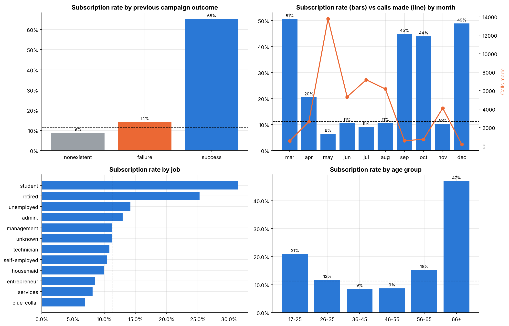
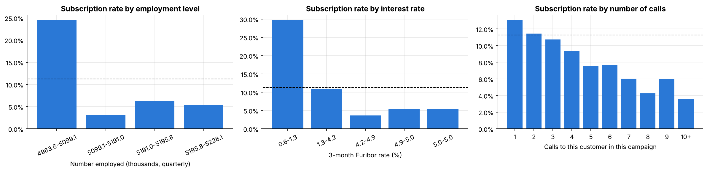
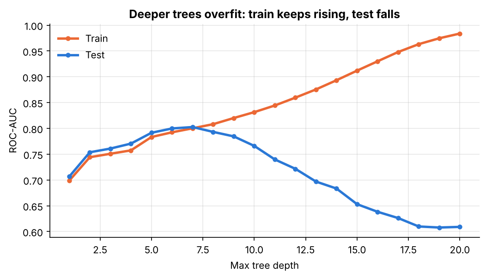
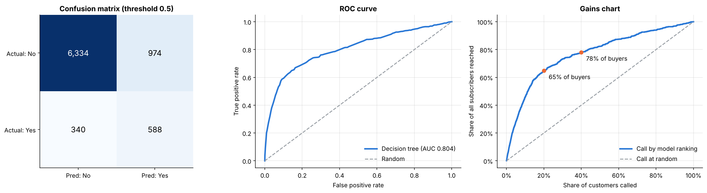
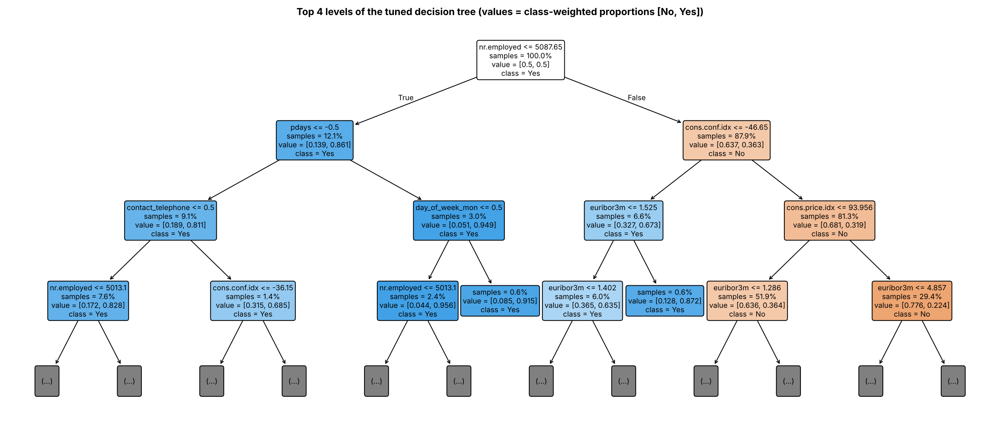

# Task 03: Predicting Term-Deposit Subscriptions with a Decision Tree

Task 03 of the Prodigy InfoTech Data Science Internship: build a decision tree classifier to predict whether a customer will purchase a product or service based on their demographic and behavioral data.

## Problem

A Portuguese bank sells term deposits by phone, but only **11.3%** of customers say yes. **Before calling, can we rank customers by how likely they are to subscribe**, so agents call the most promising ones first?

- **Target:** `y` (subscribed yes/no)
- **Model:** decision tree, because its rules are easy for the bank to read and explain
- **Success measures:** ROC-AUC, precision/recall for "yes", and **lift** (extra buyers reached per call)

## Data

UCI [Bank Marketing](https://archive.ics.uci.edu/dataset/222/bank+marketing) (`bank-additional-full.csv`): 41,188 calls from May 2008 to November 2010, with 20 features: customer profile, current and past campaign contacts, and economic indicators. I used the copy in Prodigy's [sample datasets repo](https://github.com/Prodigy-InfoTech/data-science-datasets/tree/main/Task%203).

## Cleaning and design decisions

| Issue | Decision |
|---|---|
| Missing values coded as `"unknown"` (e.g. 8,597 in `default`) | Kept as their own category; not knowing can itself be informative |
| 12 duplicate rows | Dropped |
| `pdays = 999` means "never contacted" (96%) | Added a `contacted_before` flag and recoded 999 to -1 |
| **`duration` (call length) is only known after the call** | **Excluded to avoid data leakage.** With it, ROC-AUC jumps to 0.940, but the model would be useless before a call |
| Only 11% "yes" | Stratified split and `class_weight="balanced"`; judged by AUC, recall and lift, not accuracy |

## Exploratory findings

- Customers who said **yes in a previous campaign subscribe at 65%**, compared with 9% for customers never contacted before.
- **May had the most calls but the lowest success (6%)**. March, September, October and December had few calls but 44-51% success.
- **Students (31%), retirees (25%) and customers over 65 (47%)** subscribe most. Blue-collar and services workers subscribe least (7-8%).
- **Mobile phone** calls succeed at 14.7%, compared with 5.2% for landlines.

- Success was much higher when employment and interest rates were low (2009-2010).
- Each extra call to the same person lowers the conversion rate.

## Model

An unrestricted tree grows to depth 34 with 4,988 leaves and **memorizes the training data**: train AUC 1.000, test AUC 0.627. Limiting depth fixes this:

I tuned the tree with 5-fold cross-validated grid search (depth, minimum leaf size, criterion). The best settings were `entropy`, `max_depth=12`, `min_samples_leaf=200`, giving 97 leaves.

| Metric (test set, 8,236 calls) | Value |
|---|---|
| ROC-AUC | **0.804** |
| Average precision | 0.467 (random: 0.113) |
| Recall for "yes" | 63.4% |
| Precision for "yes" | 37.6% (vs 11.3% base rate) |

**Business result (gains chart):**

| Call the top… | Subscribers reached | Lift vs random | Conversion |
|---|---|---|---|
| 10% | 46% | 4.6x | 52% |
| 20% | 65% | 3.2x | 36% |
| 30% | 73% | 2.4x | 28% |

The top split is on employment level (`nr.employed`), which mostly captures *when* the call was made. After that, the tree checks whether the customer was contacted before, then mobile vs landline.

## Conclusions

1. Using only information available before the call, the tree ranks customers well. **Calling the top 20% reaches 65% of all subscribers.**
2. **Timing and the economy** are the strongest predictors, followed by past campaign results and contact type.
3. **Recommendations:** call customers in the model's order, prioritize past subscribers and mobile numbers, avoid May-style high-volume campaigns, and stop after 2-3 calls per person.
4. Checking for leakage (`duration`) mattered as much as tuning the model.

## Limitations

- The economic features mostly identify the 2008-2010 period, so the model needs retraining for a different economy.
- A single tree is readable but less accurate than random forests or gradient boosting, which would be the next step.

## Run it

Click the Colab badge above and choose **Runtime > Run all** (about 1 minute). The notebook downloads the data itself. It requires pandas, numpy, matplotlib and scikit-learn.

## Tools

Python, pandas, NumPy, Matplotlib, scikit-learn, Google Colab
