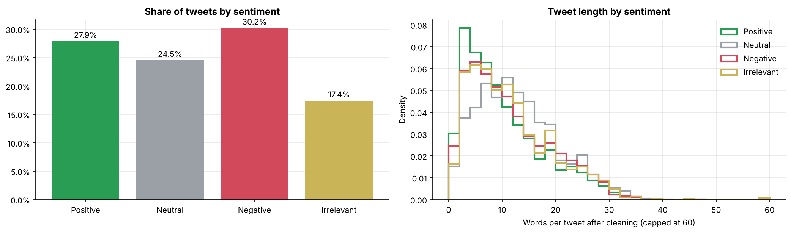
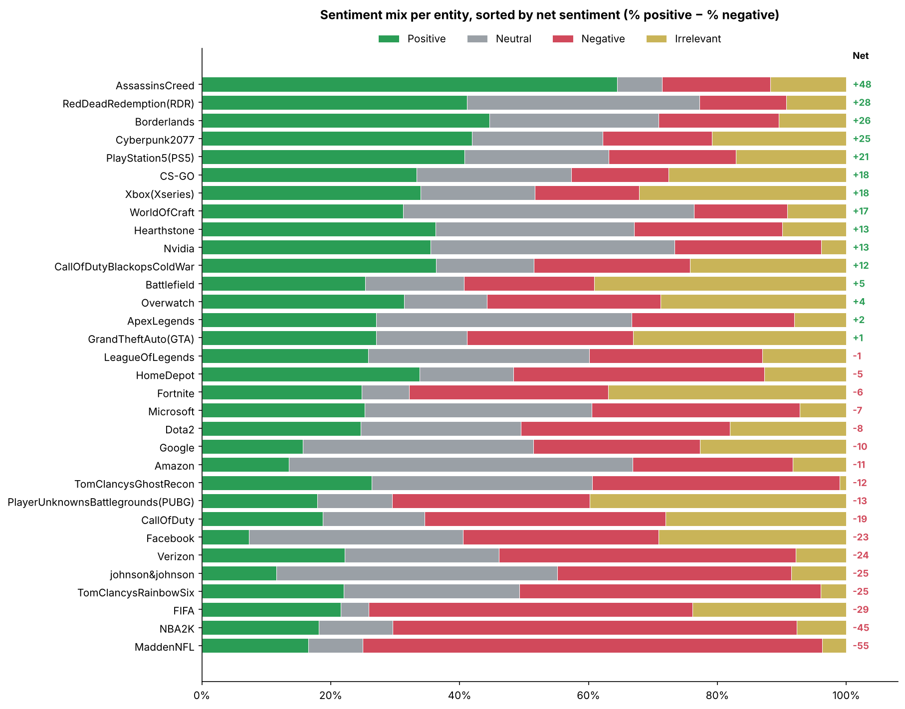
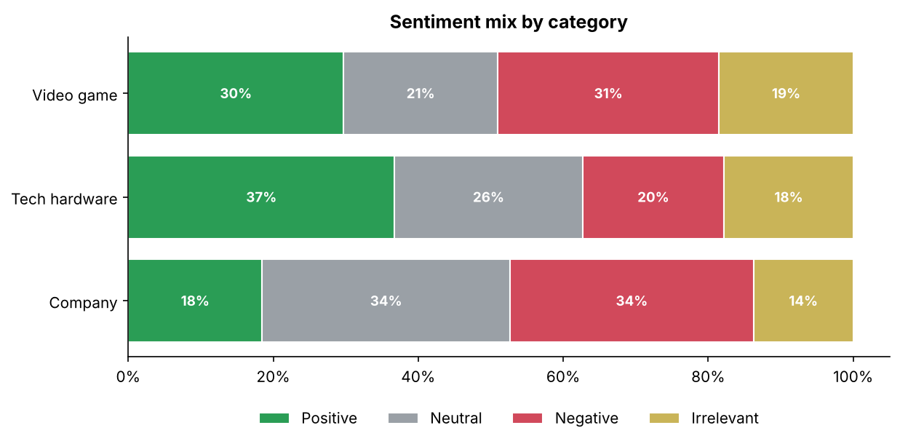
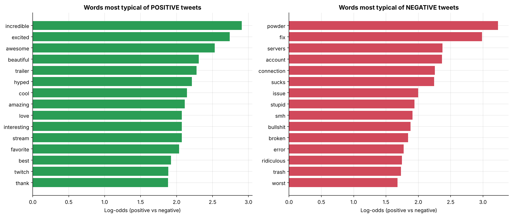
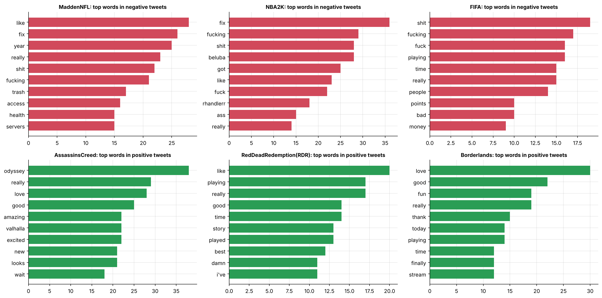
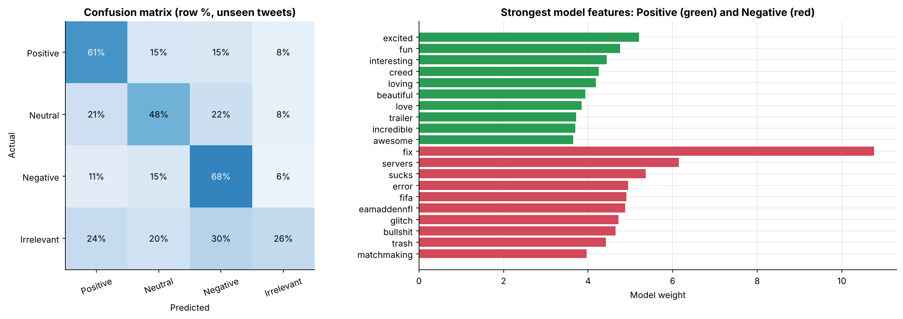

# Task 04: Social Media Sentiment Toward Brands and Games

Task 04 of the Prodigy InfoTech Data Science Internship: analyze and visualize sentiment patterns in social media data to understand public opinion and attitudes towards specific topics or brands.

## Problem

A brand or community manager wants to know **how people feel** about their product on Twitter, how it compares with competitors, **what people praise and complain about**, and whether sentiment can be labeled automatically to track it going forward.

## Data

[Twitter Entity Sentiment Analysis](https://www.kaggle.com/datasets/jp797498e/twitter-entity-sentiment-analysis) (training file, from Prodigy's [sample datasets repo](https://github.com/Prodigy-InfoTech/data-science-datasets/tree/main/Task%204)): 74,682 rows about 32 entities (video games, consoles and companies such as Amazon, Google and Verizon), labeled Positive, Negative, Neutral or Irrelevant.

## The key data-quality finding

Every tweet ID appears **exactly 6 times**: the original plus 5 slightly reworded copies, all with the same label. So the dataset holds only **12,447 unique tweets**.

- **For opinion analysis** I keep one row per tweet, so no tweet is counted six times.
- **For the classifier** I split train and test **by tweet ID**, so copies of a test tweet are never in the training set.

Ignoring this would have inflated the model's accuracy from **54% to 90%** (see Model below).

Other cleaning: dropped 686 empty texts; removed URLs, @mentions, numbers, punctuation and stop words; and removed words that just name the brand, so word lists show opinions rather than topics.

## Findings

Opinion is split: **30.2% negative, 27.9% positive**, 24.5% neutral, 17.4% irrelevant.

**Net sentiment** = % positive − % negative:

- **Most liked:** Assassin's Creed (+48), Red Dead Redemption (+28), Borderlands (+26), Cyberpunk 2077 (+25), PlayStation 5 (+21)
- **Most disliked:** MaddenNFL (−55), NBA2K (−45), FIFA (−29), Rainbow Six (−25), Johnson & Johnson (−25), Verizon (−24)

Tech hardware (PS5, Xbox, Nvidia) is the most positive group (net +17). Big companies are the most negative (net −15) and have the most neutral, news-like tweets.

Words are ranked by log-odds (how much more typical they are of one sentiment than the other):

- **Positive:** incredible, excited, awesome, beautiful, trailer, hyped, love, best
- **Negative:** fix, servers, account, connection, issue, broken, error. These are about **things not working**. "Powder" is the top negative word because of the Johnson & Johnson talc lawsuits.

Sports-game complaints center on bugs and fixes, with blame aimed at the developers (EA, Beluba).

## Model: automatic sentiment classification

TF-IDF (single words and word pairs) + logistic regression, 4 classes:

| Evaluation | Accuracy |
|---|---|
| Majority-class baseline | 30.0% |
| **Split by tweet ID (honest, unseen tweets)** | **54.0%** (macro F1 0.506) |
| Naive random split (leaky) | 90.3% |

Negative (68% recall) and Positive (61%) are recognized best. Irrelevant is hardest (26%) because off-topic tweets can still be emotional.

## Conclusions and recommendations

1. Sports games have a serious perception problem, driven by bug and server complaints, so patch quality is the lever.
2. Story-driven games and new consoles get the most positive opinion.
3. Words like "fix", "servers", "connection" and "error" make a ready-made alert list for community and reliability teams.
4. Track net sentiment per brand over time and alert when the negative share rises.
5. When data contains near-duplicates, split by group (here, tweet ID) or the model's performance will be badly overstated.

## Limitations

- The tweets were collected and labeled for this dataset (not a random sample), with about the same number per entity by design.
- Bag-of-words models miss sarcasm and context. A fine-tuned transformer (e.g. Twitter-RoBERTa) is the next step.
- There are no dates, so trends over time can't be analyzed.

## Run it

Click the Colab badge above and choose **Runtime > Run all** (about 1-2 minutes). It requires pandas, numpy, matplotlib and scikit-learn.

## Tools

Python, pandas, NumPy, Matplotlib, scikit-learn (TF-IDF, logistic regression, GroupShuffleSplit), Google Colab
