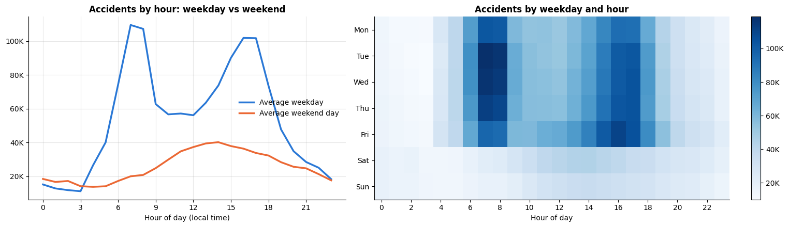
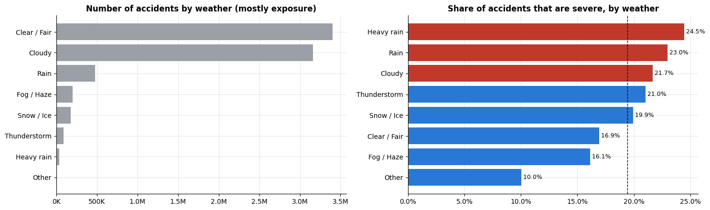
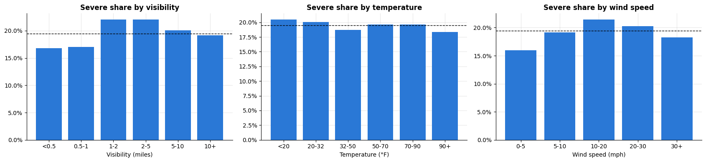
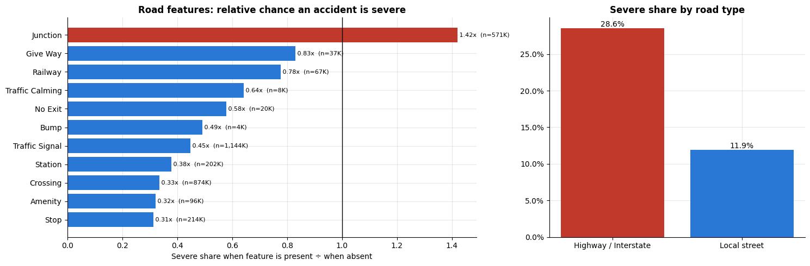
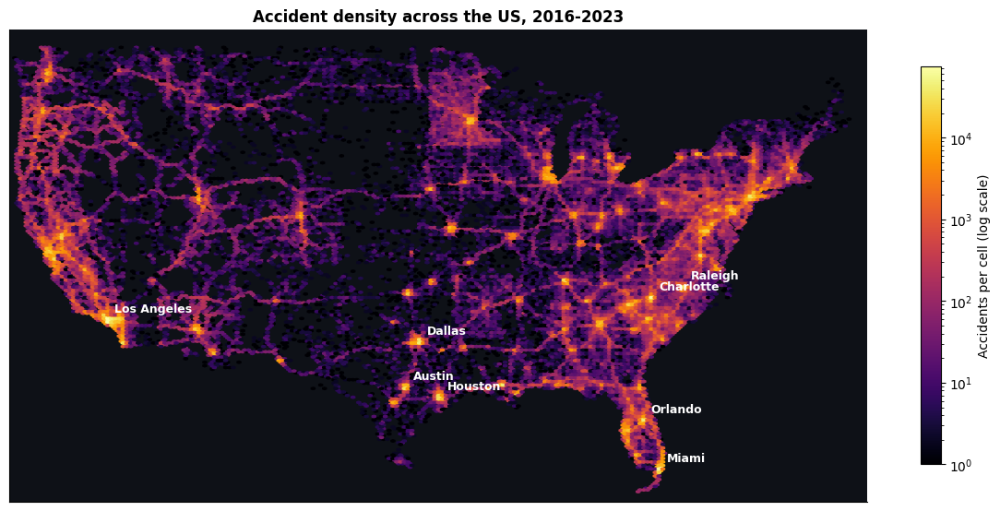
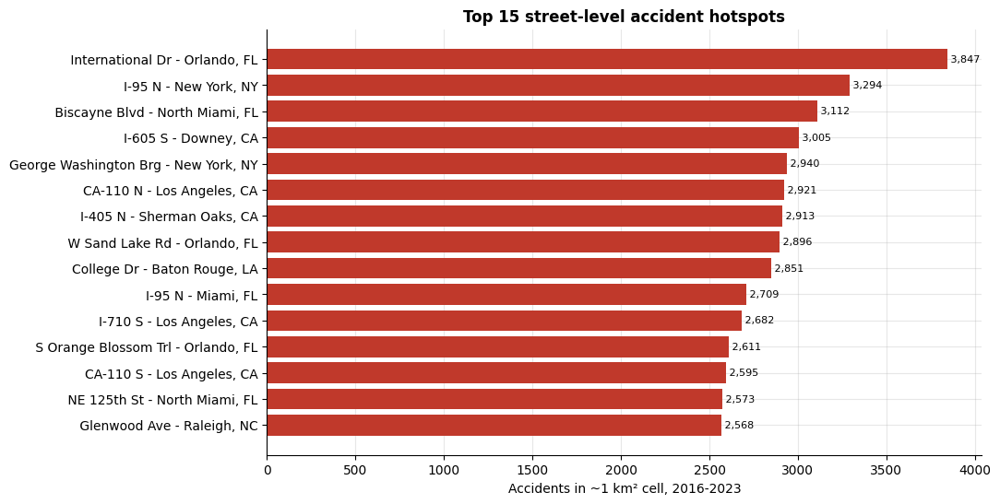
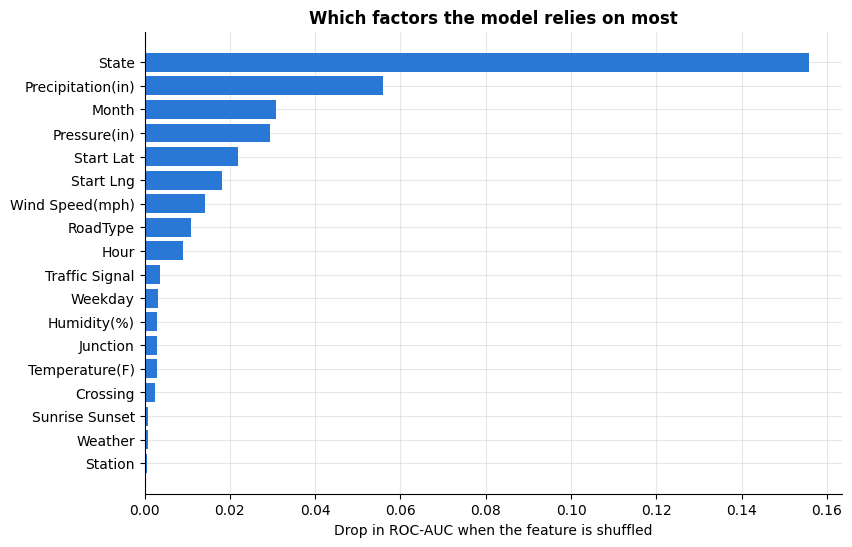

# Task 05: US Traffic Accidents, Hotspots and Contributing Factors

Task 05 of the Prodigy InfoTech Data Science Internship: analyze traffic accident data to identify patterns related to road conditions, weather and time of day, and visualize accident hotspots and contributing factors.

## Problem

A traffic-safety agency has a limited budget for enforcement, signage and road redesign. It needs to know **where**, **when** and **under what conditions** to act.

| # | Question |
|---|---|
| Q1 | When do accidents happen (hour, weekday, month)? |
| Q2 | Which weather conditions are linked to more severe accidents? |
| Q3 | Which road features are linked to severity? |
| Q4 | Where are the hotspots, at state, city and street level? |
| Q5 | Which factors best predict whether an accident is severe? |

**Counts vs. risk:** the data only contains accidents, not all trips. More accidents in clear weather doesn't mean clear weather is dangerous; most driving happens in clear weather. So for contributing factors I compare the **share of accidents that are severe** (Severity 3-4) across conditions.

## Data

[US Accidents (2016 - 2023)](https://www.kaggle.com/datasets/sobhanmoosavi/us-accidents) by Sobhan Moosavi: **7,728,394 accidents** from 49 US states, January 2016 to March 2023. The notebook downloads it with `kagglehub` and loads only the 33 needed columns with compact types (3.3 GB in memory), so it runs on free Colab.

## Key findings

| | Finding |
|---|---|
| ⏰ Time | Weekday peaks at **7-8 AM and 4-5 PM**. Weekends hold only **15.9%** of accidents. |
| 🌙 Night | Not more severe per accident: **18.9%** severe at night vs **19.7%** by day. |
| 🌧️ Weather | **Rain (23.0%) and heavy rain (24.5%)** have the highest severe share vs 16.9% in clear weather. Snow, fog and low visibility are *not* above average. |
| 🛣️ Road type | **28.6%** of highway/interstate accidents are severe vs **11.9%** on local streets (2.4x). |
| 🚦 Road features | **Junctions** raise severity (1.42x). Traffic signals, crossings and stops are linked to much less severe accidents (0.3-0.45x). |
| 📍 Hotspots | Top 5 states (CA, FL, TX, SC, NY) hold **50.9%** of accidents. Worst ~1 km cell: **International Dr, Orlando (3,847)**. |
| 🤖 Model | Gradient boosting predicts severe accidents with **ROC-AUC 0.866** (average precision 0.44 vs 0.08 baseline). |

## Charts

When accidents happen: commute peaks on weekdays, a flat afternoon curve on weekends:

Rain, not snow or fog, has the highest share of severe accidents:

Highways and junctions are linked to severity; signals, crossings and stops to less severe accidents:

Accident density across the US (log scale):

Street-level hotspots on a ~1 km grid:

What the severity model relies on:

More charts are in [`images/`](images), and the interactive heat map is in [`hotspots_map.html`](hotspots_map.html) (download and open it in a browser).

## Method

1. **Data quality:** missing-value audit (precipitation 28.5% missing, kept as NaN rather than assumed 0), ISO 8601 timestamp parsing, and impossible weather readings set to NaN. I also checked how the three data sources label severity: Source1 marks 8% of accidents as severe, Source2 34%.
2. **Feature engineering:** hour, weekday, month, weekend flag, severe flag, weather grouped into 8 categories, and highway vs. local street parsed from the street name.
3. **Analysis:** volume by time; severe share by weather, visibility, temperature, wind and road feature (relative risk); state, city and ~1 km grid hotspots.
4. **Model:** `HistGradientBoostingClassifier` on 600K accidents from a single source (consistent labels), excluding leaky features (distance, duration). Evaluated on a 25% hold-out set, with factors ranked by permutation importance.

## Recommendations

1. Schedule patrols and incident response around **weekday rush hours**.
2. Treat **rain** as a high-risk condition (warnings, variable speed limits), not only snow and ice.
3. Prioritize **high-volume, high-severity highway segments** (I-95 New York/Miami, I-605, I-405, I-710) for safety audits.
4. Use intersection redesign and speed control on busy urban corridors such as International Dr (Orlando) and Biscayne Blvd (Miami), where crashes are frequent but rarely severe.

## Limitations

- No traffic-volume data, so counts are not accident rates.
- Severity measures traffic delay, not injuries, and sources label it differently.
- Coverage grew over time (0.7M accidents in 2017 to 1.8M in 2022), partly from data collection.
- Some model factors (precipitation, month) partly reflect data-reporting patterns.
- Results are associations, not proof of cause.

## Files

| File | Contents |
|---|---|
| `US_Accidents_Analysis.ipynb` | Full analysis, run on Colab with all outputs |
| `images/` | 11 charts |
| `top_hotspots.csv` | 15 worst ~1 km road segments |
| `hotspots_map.html` | Interactive heat map (150K-accident sample) |

## Tools

Python, pandas, NumPy, Matplotlib, scikit-learn, Folium, kagglehub, Google Colab
